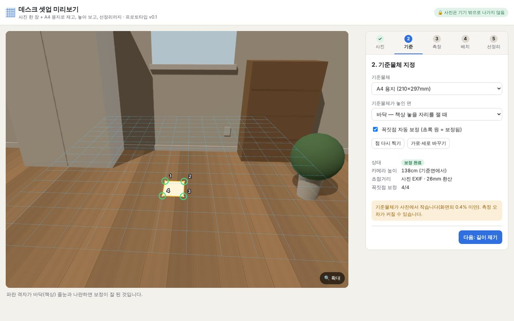
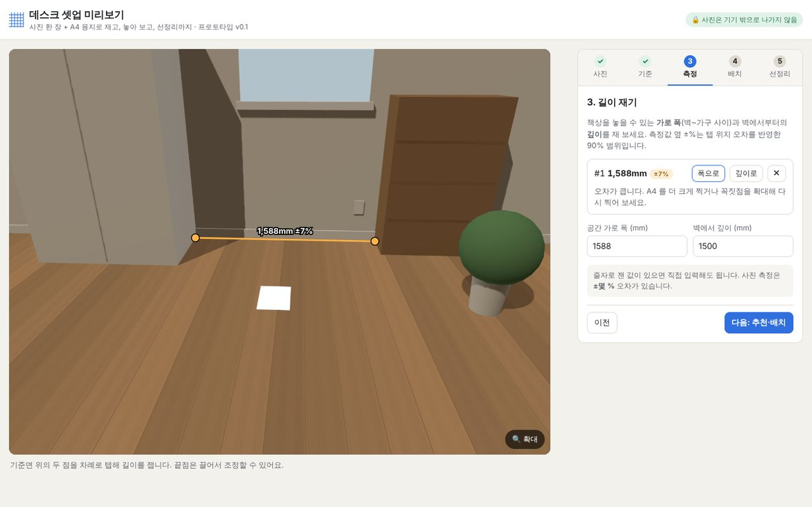
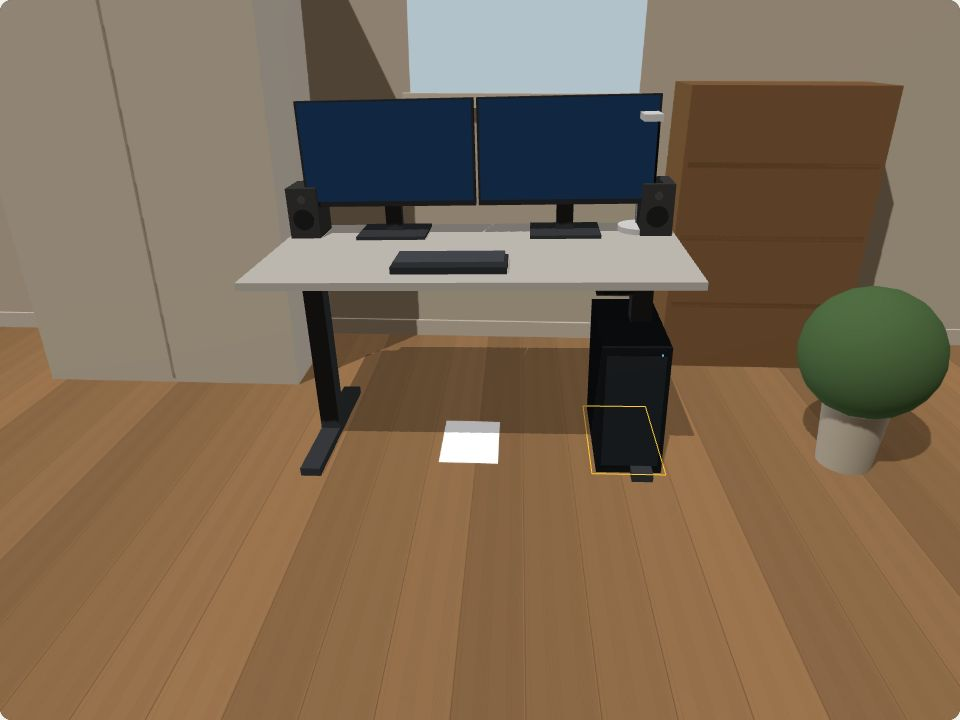
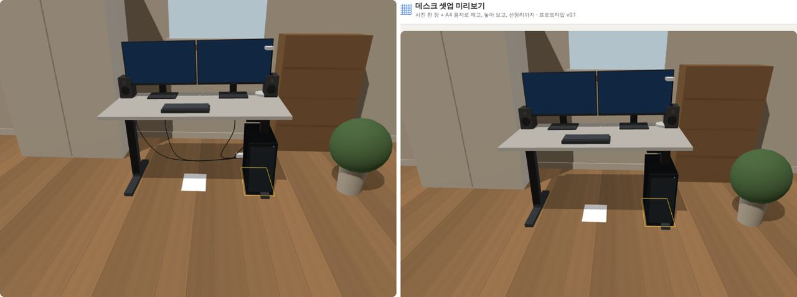

# 데스크 셋업 미리보기 (프로토타입 v0.1)

사진 한 장과 **A4 용지**로 길이를 재고, 그 공간에 맞는 책상·모니터를 추천받아 **사진 위에 3D로 놓아 보고**, 필요한 **선정리 용품**까지 추천받는 웹앱 프로토타입입니다.

> 검토 보고서: [`REPORT.md`](./REPORT.md) — 유사 서비스, 구현 제한, 오픈소스 활용, 무료 배포 시 서버·운영 비용, 관리자 검토 의견

| 1. 기준물체 보정 | 2. 길이 측정 | 3. 3D 배치 |
|---|---|---|
|  |  |  |

선정리 전/후 비교:



## 동작 방식

1. **사진**: 바닥(책상 놓을 자리) 또는 책상 상판에 A4 용지를 놓고 찍은 사진을 고릅니다. 사진은 **브라우저 안에서만** 처리되고 서버로 가지 않습니다.
2. **기준**: A4 꼭짓점 4개를 탭 → 호모그래피(평면 투영 변환)를 계산합니다. 탭 근처의 실제 꼭짓점으로 **서브픽셀 자동 보정**하고, 초점거리는 EXIF → 사각형으로 추정 → 기본값 순서로 정해 카메라 자세(높이·각도)까지 복원합니다.
3. **측정**: 같은 평면 위의 두 점 사이 거리를 mm 로 보여 주고, 탭 오차를 반영한 **±% 범위**를 함께 표시합니다.
4. **추천·배치**: 측정한 폭/깊이에 들어가는 책상, 책상에 맞는 모니터(폭·시청거리 기준, 필요하면 모니터암)를 추천하고, 치수 기반 3D 모델을 사진과 같은 원근·그림자로 그립니다. 책상 위 물건은 상판 높이로 자동으로 올라가고 책상과 함께 움직입니다.
5. **선정리**: 배치한 물건(플러그 수, 모니터 수, 모션데스크 여부, 본체 위치)으로 멀티탭 구수, 트레이 길이, 케이블 체인, 영상 케이블 길이 등을 **근거와 함께** 추천하고, 정리 전/후를 3D 로 비교합니다.

## 실행

```bash
npm install
npm run dev        # 개발 서버
npm test           # 단위 테스트 39개 (기하·추천·코너 보정·정확도 시뮬레이션)
npm run build      # 타입체크 + dist/ 정적 빌드
```

E2E (Playwright 필요):

```bash
npm run build && npx vite preview --port 4173 &
node scripts/e2e-smoke.mjs ./e2e-out   # 데스크톱·휴대폰 화면 18개 항목 + 스크린샷
```

샘플 사진은 치수를 아는 **가상의 방을 렌더링**한 것이라 정답과 비교할 수 있습니다. (옷장~책장 사이 실제 1,600mm → 측정 1,588mm, 오차 0.75%)

## 배포 (서버 없음)

`npm run build` 결과물 `dist/` 는 정적 파일뿐이라 Cloudflare Pages 같은 정적 호스팅에 그대로 올리면 됩니다(`base: './'` 라 하위 경로도 동작). 사진 처리·추천이 모두 브라우저에서 돌기 때문에 **v0.1 은 서버·DB 가 필요 없습니다.** 제휴 링크를 넣는 순간 GitHub Pages/Vercel Hobby 는 약관상 부적합할 수 있으니 보고서 8장을 참고하세요.

## 구조

```
src/
  geometry/   linalg · homography · pose · calibrate · corner(스냅·불확실도) · exif
  catalog/    샘플 규격 카탈로그 (실제 판매 상품 아님)
  recommend/  fit.ts(책상·모니터 적합성) · cables.ts(선정리 규칙)
  scene/      render.ts(사진 원근 카메라) · models.ts(치수→3D) · cablesMesh.ts · sample.ts(가상 방)
  main.ts     5단계 UI · 포인터 조작 · 확대/돋보기
tests/        단위 테스트 + 몬테카를로 정확도 시뮬레이션
scripts/      e2e-smoke.mjs
```

## 알려진 한계

- **기준물체와 같은 평면** 위의 길이만 잴 수 있습니다(벽 높이, 가구 윗면 등은 불가).
- 실제 사진(렌즈 왜곡, 흔들림, 휜 종이, 러그)으로는 아직 검증하지 않았습니다. 샘플은 CG 입니다.
- 가상 물건이 실제 물건 **뒤로 가려지지 않습니다**(가림 처리 없음). 곡면 모니터는 평면으로 그립니다.
- 카탈로그는 흔한 규격을 일반화한 **예시**이며 가격·재고 정보가 없습니다.
