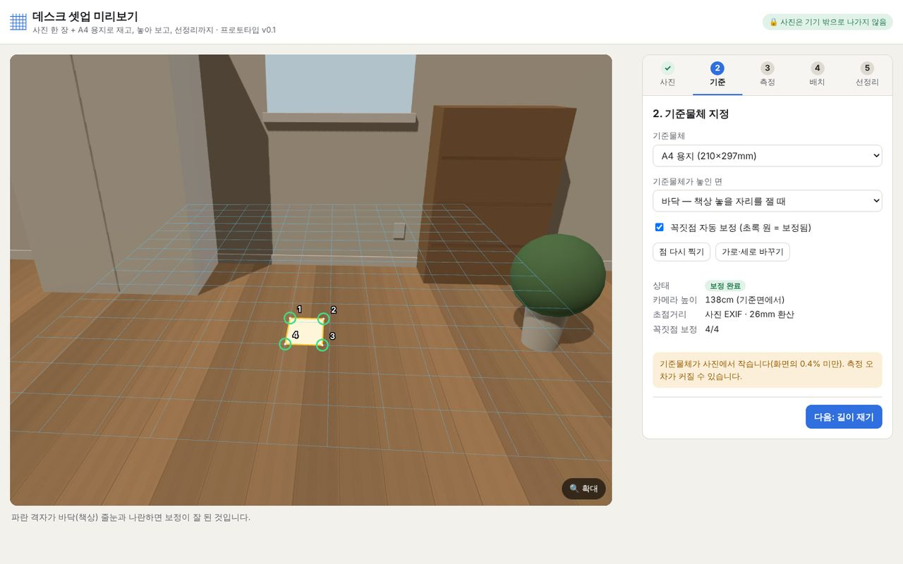
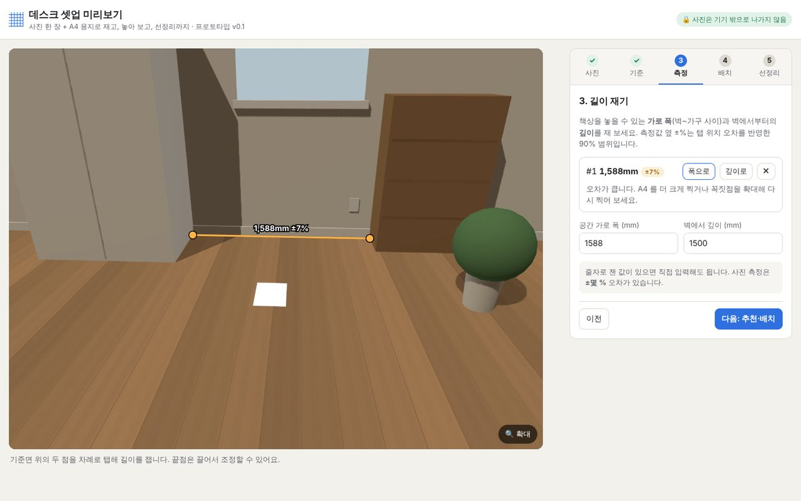
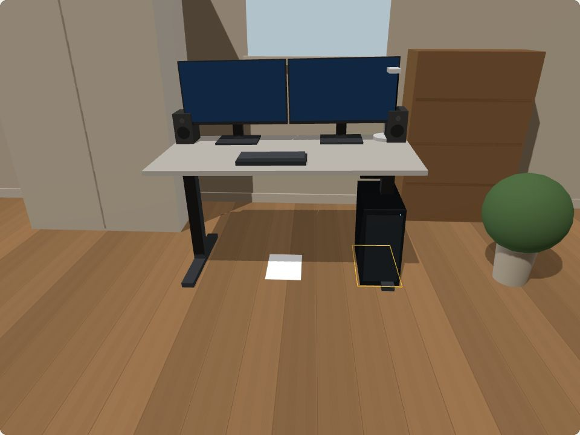
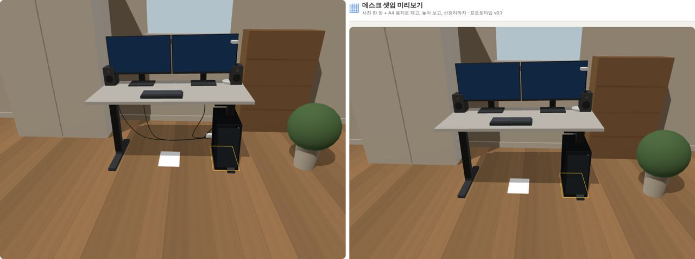
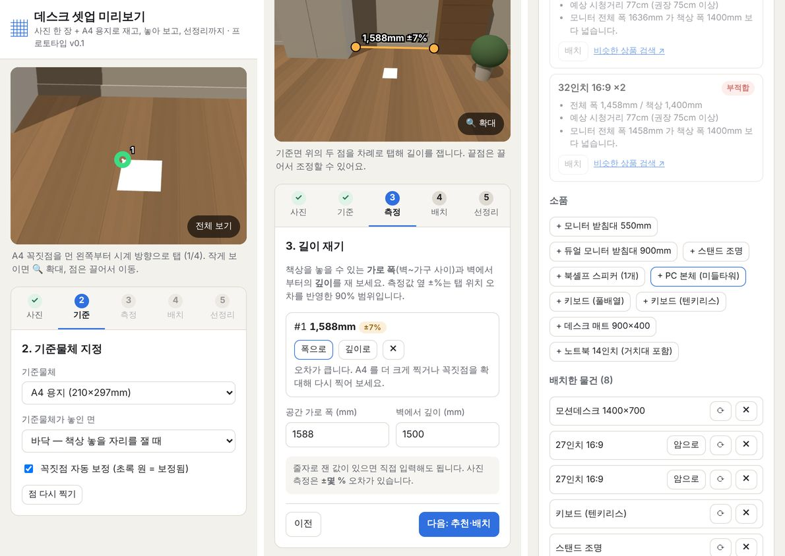

# 가상 데스크테리어 앱 — 구현 가능성 검토 보고서

| 항목 | 내용 |
|---|---|
| 작성일 | 2026-11-04 |
| 대상 | "카메라로 길이를 재고 → 맞는 제품을 골라 → 내 방 사진에 입체적으로 배치 → 선정리 용품까지 추천"하는 앱 |
| 산출물 | ① 동작하는 웹 프로토타입 (`desk-decor/`) ② 본 보고서 (개발자 검토 + 관리자 검토 + 무료 배포 운영안) |
| 검증 | 단위 테스트 39개 통과, 브라우저 E2E 18/18 통과(데스크톱·휴대폰 화면), 몬테카를로 정확도 시뮬레이션 |

---

## 0. 한 장 요약

**결론: 구현 가능. 단, "사진 한 장으로 방 전체를 정밀 측정"은 약속하면 안 되고, "책상 주변 규모 + 기준물체(A4)"로 범위를 좁혀야 한다.**

| 질문 | 답 |
|---|---|
| 비슷한 앱이 있나? | **부분적으로 있다.** IKEA Kreativ·오늘의집(방 단위 가구 배치), DeskSpacing(웹 3D 책상 플래너), DeskFlow(포트·케이블 호환 플래너) 등. 다만 **"측정 → 치수 적합성 추천 → 사진 위 배치 → 선정리 추천"을 데스크 영역에 특화해 한 흐름으로 묶은 서비스는 이번 조사 범위에서는 찾지 못했다.** (앱스토어 전수조사는 아님) |
| 구현에 제한이 있나? | 있다. ① 사진 한 장 측정은 **기준물체와 같은 평면**에서만 되고, 방 규모에서는 탭 오차에 매우 민감(시뮬레이션 중앙값 9~12%). ② iOS Safari 는 WebXR AR 을 지원하지 않아 웹으로는 실시간 AR 불가. ③ **가장 큰 병목은 기술이 아니라 "상품 치수 데이터"** — 쇼핑 API 는 가로×깊이×높이를 구조화해 주지 않는다. ④ 제휴 표시·라이선스·스토어 정책 등 운영 규정. |
| 소스코드를 구해 일부 구현 가능한가? | **가능하고, 이미 핵심을 구현했다.** three.js(MIT)로 3D, 측정 수학(호모그래피·카메라 자세·코너 보정)은 직접 구현(외부 CV 라이브러리 없이 약 700줄). 다음 단계용 오픈소스(OpenCV.js, model-viewer, ARCore 샘플, ViroReact 등)도 라이선스상 사용 가능. 단, **Hunyuan3D 는 한국이 라이선스 지역에서 제외**, Depth Anything V2 Base/Large 는 비상업 라이선스라 쓰면 안 된다. |
| 3D 모델링이 너무 복잡하지 않나? | **사진을 3D 로 복원할 필요는 없다.** 제품은 **치수(W×D×H)만으로 박스·원기둥을 조합한 파라메트릭 모델**로 충분히 "약간 입체적"으로 보인다(프로토타입 스크린샷 참조). 많이 팔리는 소수 제품만 실제 3D(GLB)로 보강하면 된다. |
| 무료 배포 시 서버는? | **1단계(웹)는 서버가 필요 없다** — 사진 처리·추천이 모두 브라우저에서 동작, 정적 호스팅 무료 플랜으로 0원. 상품 가격 갱신은 "하루 1회 자동 빌드"로 서버 없이 가능. 계정·클라우드 저장을 넣는 3단계부터 월 수만 원. **진짜 비용은 서버가 아니라 상품 데이터 관리 인력 시간.** |

권장 경로: **① 웹 베타(지금 프로토타입 확장, 0원) → ② 실사진 검증·상품 300개 정리·제휴 연결 → ③ 반응이 확인되면 네이티브 AR(ARKit/ARCore)로 방 규모 측정 추가.**

---

## 1. 요구사항 정리

| # | 요청 | 프로토타입에서 구현한 방식 | 상태 |
|---|---|---|---|
| 1 | 방의 한 면/꾸밀 자리 촬영 | 사진 선택·촬영(`capture=environment`), 사진은 기기 밖으로 전송하지 않음 | ✅ |
| 2 | 카메라로 대략 길이 측정 → 맞는/지정 크기 상품 선택 (추천 또는 직접 선택) | A4·신용카드·A3 기준물체 4점 → 호모그래피 측정, ±% 오차 표시, 줄자 값 직접 입력도 가능 / 공간에 맞는 책상, 책상에 맞는 모니터 추천 + 직접 추가 | ✅ (평면 위 측정만) |
| 3 | 상품을 대략적·약간 입체적으로 내 방에 구현 | 사진과 같은 원근(복원한 카메라 자세)으로 치수 기반 3D 모델 + 접지 그림자, 끌어서 이동·회전, 책상 위 물건 자동 적층 | ✅ |
| 4 | 책상·모니터 배치 후 선정리 장치 추천 | 플러그 수·모니터 수·모션데스크·본체 위치로 멀티탭/트레이/케이블 체인/케이블 길이 등 근거와 함께 추천, 3D 정리 전/후 비교 | ✅ (규칙 기반) |



---

## 2. 유사 서비스 조사

| 서비스 | 측정 | 배치 방식 | 데스크 특화 | 선정리 | 비고 |
|---|---|---|---|---|---|
| **IKEA Kreativ** (IKEA 앱) | 방 스캔(여러 장 사진 → 광각 장면) | 기존 가구 지우고 IKEA 제품 배치 | ✕ (방 전체) | ✕ | IKEA 제품만. 리뷰에서도 "측정 도구가 아니니 치수는 따로 확인하라"고 함 [S1][S2] |
| **오늘의집** 3D 방꾸미기·AI 방꾸미기·3D 인테리어 | 방 크기를 사용자가 직접 설정 | 실제 제품 형태·크기를 반영한 3D 모델 배치 | ✕ (방 단위) | ✕ | 국내 최대 경쟁자. 2026년 1월 "3D·AI 인테리어 관련 검색 24배 증가" 발표 [S3][S4] |
| **Apple 측정 앱 / RoomPlan** | AR 실시간 측정, RoomPlan 은 LiDAR 로 벽·문·가구 치수 | — (측정·평면도) | ✕ | ✕ | RoomPlan 은 iOS 16+ **LiDAR 기기 전용**, 공개된 정확도 수치는 찾지 못함 [S5] |
| **Google Measure** | ARCore 측정 | — | — | — | **2021년 6월 종료**(신규 설치 불가). 불안정·부정확 리뷰 [S6] |
| **DeskSpacing** (웹) | ✕ (치수 직접 입력) | 웹 3D 로 책상·소품 배치 | ✅ | ✕ | 사진/AR 없음. 프리셋 책상 + 사용자 지정 크기 [S7] |
| **DeskFlow** (웹) | ✕ | 기기 노드를 끌어 포트 연결 | ✅ | △ (케이블·포트 **호환성**) | 공간·배치가 아니라 포트 연결 검증 중심. 개발자 자체 소개 외 독립 리뷰 없음 [S8] |
| **Varidesk AR Office Planner** | ✕ | 인쇄한 **마커** 위에 자사 스탠딩데스크 AR 표시 | ✅ | ✕ | 자사 제품만 [S9] |
| AI 인테리어 앱 (RoomGPT·Deco 등) | ✕ | 생성형 AI 로 사진 스타일 변경 | ✕ | ✕ | 치수 개념 없음. 구매 판단 근거로는 약함 [S10] |

**시사점**
- 방 단위 가구 배치는 IKEA·오늘의집이 이미 강하다 → **정면 경쟁은 피하고 "책상 위·주변 1~2m"에 집중**하는 것이 차별점.
- 데스크 특화 도구(DeskSpacing, DeskFlow)는 **내 공간 사진**과 **치수 적합성 검증**이 없다.
- **선정리 추천**을 배치 결과와 연동한 서비스는 찾지 못했다 → 가장 뚜렷한 차별 기능.
- 한계: 웹 검색 기반 조사이며, 국내 앱스토어에서 "데스크테리어/책상 꾸미기"로 직접 전수 확인은 하지 못했다(9장 조건 C-1).

---

## 3. 구현 방식 비교 — 무엇으로 길이를 잴 것인가

| 방식 | 원리 | 정확도 | 기기 범위 | 개발 난이도 | 서버 | 판단 |
|---|---|---|---|---|---|---|
| **A. 사진 1장 + 기준물체** (프로토타입) | A4 네 꼭짓점 → 평면 호모그래피 | 책상 규모 **≈1~2%**, 방 규모는 탭 정밀도에 크게 좌우(5장) | **모든 기기·웹** | 낮음 | 불필요 | ✅ 1단계 |
| B. WebXR AR (웹) | 브라우저가 AR 세션 제공 | AR 수준 | **Android Chrome 만**. iOS Safari 는 WebXR 미지원(2026 기준) [S11] | 중간 | 불필요 | ✕ (iOS 절반 누락) |
| **C. 네이티브 AR** (ARKit/ARCore) | 실시간 SLAM + 평면 인식 | 비 LiDAR 방 규모 비공식 테스트 **3~20cm**, 평균 8.5cm [S12] | ARCore 지원 Android, iPhone | 높음 | 불필요 | ✅ 3단계 |
| D. LiDAR (RoomPlan) | 깊이 센서 | 가장 좋음(공식 수치 미공개) | **Pro 아이폰·아이패드만** | 중간 | 불필요 | △ 고급 옵션 |
| E. 단안 깊이추정 AI | 사진 1장 → 깊이 맵 | 상대 깊이는 좋지만 **절대 길이는 기준 필요** | 모든 기기(모델 다운로드) | 중간 | 선택 | △ 가림 처리용 |

**왜 A로 시작하나**: 모든 사용자가 바로 쓸 수 있고(설치 불필요), 서버가 필요 없으며, 데스크테리어의 핵심 측정 대상(책상 상판 폭, 책상 놓을 자리 폭)은 대부분 **평면 위 길이**다.

---

## 4. 프로토타입 (개발자 작업 내역)

### 4.1 구조

```
사진(브라우저 안) ─▶ 꼭짓점 4점 탭 ─▶ 코너 서브픽셀 보정 ─▶ 호모그래피 H ─┬─▶ 평면 위 길이 + ±% 오차
                                                              EXIF/추정 초점 ─┴─▶ 카메라 자세(R,t)
                                                                                  │
측정 폭·깊이 ─▶ 책상/모니터 적합성 규칙 ─▶ 추천 ─▶ 치수 기반 3D 모델 ─▶ three.js (사진과 같은 원근) ─▶ 합성
                                                         │
                               배치 결과 ─▶ 선정리 규칙 ─▶ 용품 추천 + 정리 전/후 3D
```

| 모듈 | 내용 | 규모 |
|---|---|---|
| `geometry/` | 호모그래피(Hartley 정규화 DLT), 초점거리 추정(직교 조건), 카메라 자세 복원, 서브픽셀 코너 보정(Shi-Tomasi + cornerSubPix 방식), EXIF 파서, 측정 불확실도 | 외부 라이브러리 0 |
| `recommend/` | 책상 적합(폭·깊이·의자 공간), 모니터 적합(전체 폭·시청거리·모니터암 필요 여부), 선정리 규칙 10종 | 근거 문장 포함 |
| `scene/` | OpenCV 카메라 → three.js 투영행렬 변환, 파라메트릭 3D 모델 9종, 케이블 시각화, 정답을 아는 **가상 방 샘플** | three.js (MIT) |
| 번들 | JS 609KB (gzip **160KB**, 대부분 three.js) | 정적 파일만 |

### 4.2 화면

| 길이 측정 (±% 오차 표시) | 3D 배치 (모션데스크 + 27" ×2 + 소품) |
|---|---|
|  |  |

선정리 전(왼쪽: 선이 바닥 멀티탭으로 늘어짐) / 후(오른쪽: 트레이·체인으로 정리, 바닥으로 1가닥):



휴대폰(390px): ×3 확대로 꼭짓점 찍기 → 측정 → 추천 목록



### 4.3 테스트 결과

| 종류 | 결과 | 내용 |
|---|---|---|
| 단위 테스트 | **39/39 통과** | 호모그래피, 자세 복원(높이 1,300mm 복원), 반시계 클릭·A4 가로/세로 자동 판정, EXIF, 코너 보정(4px 빗나간 탭 → 0.5px 이내), 추천·선정리 규칙 |
| 브라우저 E2E | **18/18 통과** | 데스크톱 1440px·휴대폰 390px에서 보정 → 측정 → 배치 → 선정리 전 과정, 3D 렌더링 확인, 콘솔 오류 0, 가로 스크롤 0 |
| 측정 정확도 (E2E) | 실제 1,600mm → **1,588mm (0.75%)** | 가상 방(CG) 샘플, 꼭짓점을 일부러 2~3px 빗나가게 탭 → 자동 보정 4/4 |

**E2E 가 잡아낸 실제 결함 3건(수정 완료)** — 테스트를 통과만 시킨 것이 아니라 스크린샷을 직접 확인해 찾음:
1. 휴대폰에서 A4 가 화면상 20px 남짓이라 두 번째 탭이 첫 점을 "끌기"로 인식 → 점이 안 찍힘. **확대(×3) 버튼 + 탭/끌기 판정 반경 축소**로 수정.
2. 안내문 줄 수가 바뀌면 페이지가 20px 튀어 **탭 사이에 사진이 손가락 밑에서 움직임** → 안내문 높이 고정.
3. 휴대폰에서 오차 표시가 "±356%"로 과장(꼭짓점은 서브픽셀로 정확한데 같은 오차 모델 적용) → 꼭짓점·끝점 오차를 분리, 30% 초과는 "오차 큼" 표기. 수정 후 표시 ±7% ⊇ 실제 0.75%.

---

## 5. 측정 정확도 — 시뮬레이션으로 본 한계

4032×3024 사진(26mm 환산), 탭 위치에 가우시안 오차를 넣어 2,000회 반복 (`tests/accuracy.sim.test.ts`).

| 시나리오 | 기준물체 크기(px) | 중앙값 오차 | 90% 오차 | 앱이 거부 |
|---|---:|---:|---:|---:|
| 바닥 · A4를 카메라 앞(측정 대상과 1.5m 떨어짐) · **자동 꼭짓점 검출 σ=1px** | 261 | 2.1% | 5.5% | 0% |
| 바닥 · A4를 카메라 앞 · 신중한 탭 σ=4px | 261 | 9.3% | 27.8% | 0% |
| 바닥 · A4를 카메라 앞 · 대충 탭 σ=12px | 261 | 35.1% | 348.6% | 0% |
| 바닥 · A4를 측정 대상 바로 옆 · **자동 검출 σ=1px** | 120 | **0.7%** | 1.9% | 0% |
| 바닥 · A4를 측정 대상 바로 옆 · 신중한 탭 σ=4px | 120 | 11.7% | 65.0% | 0% |
| 바닥 · A4를 측정 대상 바로 옆 · 대충 탭 σ=12px | 120 | 57.7% | 499.0% | 0% |
| 바닥 · A3(=A4 2장)를 측정 대상 옆 · 신중한 탭 σ=4px | 174 | 2.3% | 37.9% | 0% |
| 바닥 · 신용카드를 측정 대상 옆 · σ=4px | 33 | — | — | **100%** |
| **책상 위 · A4 · 상판 폭 1.2m · 신중한 탭 σ=4px** | 466 | **1.3%** | 3.3% | 0% |
| 책상 위 · A4 · 상판 폭 1.2m · 대충 탭 σ=12px | 466 | 4.8% | 14.7% | 0% |

평면 밖 측정 예: 바닥 기준으로 높이 300mm(서랍장 윗면)의 1,600mm 를 재면 **2,080mm (오차 30%)** → 평면 밖은 원리적으로 불가.

**해석 (처음 가정이 틀렸던 부분 포함)**
- 처음에는 "A4 를 측정 대상 옆에 두면 정확해진다"고 가정했으나, **멀리 둔 A4 는 사진에서 작아져(120px) 오히려 탭 오차에 더 취약**했다. 정확도를 가르는 변수는 위치가 아니라 **기준물체가 사진에서 차지하는 픽셀 크기와 꼭짓점 정밀도**다.
- **꼭짓점 자동 검출(σ≈1px)이 오차를 약 5배 줄인다** → 프로토타입에 서브픽셀 코너 보정을 넣은 근거. 가상 방 E2E 에서 0.75% 확인.
- **책상 규모는 실용 수준(중앙값 1.3%)**, 방 규모는 자동 검출 없이는 신뢰하기 어렵다(중앙값 9~12%, 꼬리가 매우 김).
- 따라서 UX 원칙: ① 측정마다 ±% 표시 ② 오차가 크면 재촬영 안내 ③ 기준물체가 너무 작으면 거부 ④ **줄자 값 직접 입력을 항상 허용**.

> 주의: 위 수치는 렌즈 왜곡·흔들림·휜 종이·러그 등 **실사진 요인을 빼고 탭 오차만 모델링**한 것이다. 실사진 오차는 이보다 크다(9장 지적 F-1).

---

## 6. 구현 제한과 리스크

### 6.1 기술

| # | 제한 | 영향 | 대응 |
|---|---|---|---|
| T1 | 기준물체와 **같은 평면** 위 길이만 측정 | 벽 높이·가구 윗면 측정 불가. 앱은 평면 "지평선 너머" 탭만 막을 수 있고, 가구 윗면처럼 평면 위로 떠 있는 점은 **구분하지 못해 틀린 값을 낸다**(5장: 30% 오차) | 지평선 너머 탭 차단(구현) + "바닥/상판에 닿은 점만 재세요" 안내, 높이는 직접 입력, 3단계에서 네이티브 AR |
| T2 | 방 규모 측정 정확도 | 5장 참조 | 코너 자동 보정(구현), 다음 단계 A4 자동 검출(OpenCV.js) |
| T3 | **가림(occlusion) 미처리** | 실제 의자가 앞에 있어도 가상 책상이 위에 그려짐 | 단안 깊이추정(Depth Anything V2 **Small**, Apache-2.0)으로 가림 마스크, 또는 사용자가 붓으로 앞 물체 칠하기 |
| T4 | 조명·색 불일치, 곡면 모니터 평면 표시 | 사실감 저하 | 사진 평균 밝기로 조명 보정, 인기 제품만 GLB |
| T5 | iOS 웹 AR 불가 | 웹으로 실시간 AR 불가 | 1단계는 사진 방식, 개별 제품 미리보기는 model-viewer → iOS AR Quick Look(USDZ 자동 생성) [S13] |
| T6 | 사진 크기·메모리 | 12MP 이상 사진 전체 디코딩 시 휴대폰 메모리 부담 | 코너 보정은 주변 패치만 읽음(구현), 합성 이미지 2048px 제한(구현) |

### 6.2 데이터 — **가장 큰 병목**

| # | 제한 | 설명 |
|---|---|---|
| D1 | **상품 치수 데이터 부재** | 쇼핑 검색 API 는 상품명·가격·이미지·링크 위주이고 **가로×깊이×높이, VESA, 클램프 두께 범위, 패널 실측** 같은 구조화 필드가 없다. 추천의 품질은 전적으로 이 데이터에 달려 있다. → 직접 정리한 치수 DB 가 필요하고, 이것이 운영 인력 비용의 대부분이다. |
| D2 | 3D 모델 | 제조사가 GLB 를 주는 경우가 드물다. 파라메트릭 모델(구현)로 대부분 대체, 인기 상위 제품만 직접 모델링/구매. 이미지→3D 생성 AI 는 라이선스 확인 필수(6.3). |
| D3 | 쿠팡 파트너스 API | 블로그 자료 기준, **최종 승인(누적 판매 약 15만 원) 이후에** API 사용 가능하고 호출 제한(시간당 30회 초과 시 정지 등)이 있다는 비공식 정보가 있다 [S14]. → 초기에는 API 없이 검색 링크로 시작. |
| D4 | 네이버 쇼핑 검색 API | 네이버 검색 API 가 **NAVER API HUB(네이버 클라우드)로 이전 중**이며 "한시적 무료, 유료 전환 시 사전 공지"라고 안내된다 [S15]. 무료 지속을 전제로 설계하면 안 된다. |

### 6.3 법·정책·라이선스

| # | 항목 | 내용 | 대응 |
|---|---|---|---|
| L1 | 추천·보증 표시 | 공정위 「추천·보증 등에 관한 표시·광고 심사지침」: 경제적 이해관계(제휴 수수료)를 **제목·첫 부분 등 쉽게 보이는 곳**에 표시. 미표시 시 제휴 정산 제외·계정 정지 위험(플랫폼 정책 블로그 자료) [S16] | 제휴 링크가 있는 모든 카드에 "제휴 링크 · 구매 시 수수료를 받을 수 있음" 표시 |
| L2 | AI 모델 라이선스 | **Tencent Hunyuan3D 2.0/2.1: 라이선스 "지역"에서 EU·영국·한국 제외** → 한국 서비스에 사용 불가 [S17]. **Depth Anything V2: Small 만 Apache-2.0, Base/Large/Giant 는 CC-BY-NC-4.0(비상업)** [S18]. TRELLIS.2 는 MIT 로 소개되나 1차 저장소 확인 필요 [S19] | 사용 전 원문 LICENSE 확인 절차를 체크리스트화 |
| L3 | 호스팅 약관 | **GitHub Pages: 온라인 비즈니스·상거래 목적 사이트의 무료 호스팅 불허**, 월 100GB 소프트 제한 [S20]. **Vercel Hobby: 비상업 개인용만**, 제휴 링크가 주목적이면 상업으로 봄 [S21] | 제휴 수익화 시 Cloudflare Pages 등 상업 이용 가능한 곳으로 |
| L4 | 앱스토어 | Apple 개발자 프로그램 연 99달러, Google Play 1회 25달러 [S22]. **2023-11-13 이후 만든 Google Play 개인 계정은 테스터 12명 × 14일 비공개 테스트 후에야 프로덕션 출시 가능** [S23] | 일정에 2~3주 반영, 또는 D-U-N-S 로 조직 계정 |
| L5 | 개인정보 | 방 사진은 생활공간이 드러나는 민감한 정보 | 사진을 서버로 보내지 않는 구조 유지(구현), 개인정보처리방침에 "수집하지 않음" 명시, 스토어 개인정보 라벨 작성 |
| L6 | 상표·이미지 | 브랜드명·제품 사진 | 제휴 API 가 허용한 이미지만 원본 링크로 사용, 임의 가공 금지 |

---

## 7. 오픈소스·소스코드 활용 가능성

| 오픈소스 | 용도 | 라이선스 | 이번 판단 |
|---|---|---|---|
| **three.js** | 3D 렌더링, 레이캐스팅, 그림자 | MIT | ✅ 프로토타입에 사용 |
| OpenCV.js | A4 자동 검출(윤곽·코너), ArUco 마커 | Apache-2.0 (4.5+) | ✅ 다음 단계 (용량 수 MB → 지연 로딩) |
| Google model-viewer | 개별 상품 AR 미리보기 (Android Scene Viewer/WebXR, iOS Quick Look·USDZ 자동 생성) | Apache-2.0 | ✅ 상품 상세 화면용 [S13] |
| Transformers.js + Depth Anything V2 **Small** | 기기 내 깊이 추정 → 가림 처리 | Apache-2.0 | ✅ (Small 만) [S18] |
| ARCore SDK 샘플 / Apple ARKit·RoomPlan 샘플 | 네이티브 AR 측정 | Apache-2.0 / Apple 샘플 라이선스 | ✅ 3단계 |
| **ViroReact** (React Native AR) | ARKit+ARCore 를 한 코드로, Expo 지원 | MIT, 유지보수 중 [S24] | ✅ 3단계 후보 |
| Unity AR Foundation | 고품질 AR | Unity 라이선스 | △ 팀 역량 따라 |
| 8th Wall | WebAR 엔진 | 2026-02 오픈소스 전환, 호스팅 종료(2027-02까지 유지). VPS 등 일부 기능 제외 [S25] | △ 장기 유지 불확실 |
| Hunyuan3D | 이미지→3D | **한국 제외 지역 라이선스** | ❌ 사용 금지 [S17] |
| Depth Anything V2 Base/Large | 깊이 추정 | CC-BY-NC-4.0 | ❌ 비상업 [S18] |

**개발자 의견**: 측정 수학은 OpenCV 없이도 수백 줄이면 충분했고, 그 덕에 번들이 작고(gzip 160KB) 동작 원리를 100% 통제할 수 있었다. 무거운 라이브러리(OpenCV.js, 깊이 모델)는 **필요한 화면에서만 지연 로딩**하는 것이 맞다.

---

## 8. 무료 배포 시 서버·운영

### 8.1 단계별 구조

| 단계 | 기능 | 필요한 서버 | 구성 |
|---|---|---|---|
| **1. 웹 베타 (현재)** | 측정·배치·선정리, 카탈로그 내장 | **없음** | 정적 호스팅(Cloudflare Pages 등)에 `dist/` 업로드 |
| **2. 상품·제휴** | 상품 300~1,000개, 가격·품절 갱신, 제휴 링크 | **없음(빌드 시점 처리)** | 치수 DB(스프레드시트/JSON) + 하루 1회 예약 빌드가 가격 API 조회 → 정적 JSON 재배포. 사용자 요청마다 API 를 부르지 않으므로 호출 제한·키 노출 문제 없음 |
| **3. 계정·저장·공유** | 로그인, 구성 저장, 링크 공유 | DB + 인증 | Supabase 등 BaaS. **사진은 계속 서버에 저장하지 않음**(구성 JSON 만) |
| **4. 네이티브 앱(AR)** | 실시간 AR 측정 | 2·3단계와 공유 | 스토어 계정 비용 추가 |

### 8.2 비용 추정 (월, 무료 배포 가정)

| 항목 | 1단계 | 2단계 | 3단계 | 근거·주의 |
|---|---|---|---|---|
| 정적 호스팅 | 0원 | 0원 | 0원 | Cloudflare 무료: Pages 정적 요청 무제한(제3자 정리), 빌드 월 500회 [S26] |
| API·서버 함수 | — | 0원 | 0원~ | Workers 무료 하루 10만 요청·요청당 CPU 10ms(공식 문서) [S26]. 2단계는 빌드 시점 처리라 거의 안 씀 |
| 파일 저장(3D 모델) | — | 0원 | 0원 | R2 무료 10GB·이그레스 무료(제3자 정리, 공식 확인 필요) [S27] |
| DB·인증 | — | — | 0원 → **약 3.5만 원** | Supabase 무료 500MB·MAU 5만, 단 **7일 비활성 시 일시정지** → 실서비스는 Pro 월 25달러 [S28] |
| 예약 빌드 | — | 0원 | 0원 | GitHub Actions(공개 저장소 무료). 비공개 저장소는 무료 분량 한도 확인 |
| 도메인 | 선택 | 연 2~3만 원 | 연 2~3만 원 | `.com`/`.kr` 일반 시세(추정) |
| 앱스토어 | — | — | — | 4단계: Apple 연 99달러 + Google 1회 25달러 [S22] |
| 오류 모니터링 | 0원 | 0원 | 0원 | 무료 플랜 범위(제품별 확인) |
| **합계** | **0원** | **월 약 2천 원(도메인 환산)** | **월 약 3.5~4만 원** | 환율·가격 변동 제외 |

트래픽 감 잡기: 첫 방문 약 0.2MB(JS 160KB gzip + 기타). **월 10만 명 × 3회 = 약 60GB** — 이 정도면 정적 호스팅 무료 범위. 다만 GitHub Pages 의 월 100GB 소프트 제한은 GLB 3D 모델을 붙이는 순간 넘을 수 있다.

### 8.3 무료 앱에서 실제로 돈·시간이 드는 곳

1. **상품 치수 데이터 관리 (최대 비용)**: 상품 1개당 치수·VESA·클램프 범위 확인 5~10분(추정) → 300개면 초기 25~50시간, 이후 신상품·단종 반영 주 2~4시간.
2. **서버 측 AI 기능은 넣지 않는다**: 생성형 이미지·LLM 상담은 사용량에 비례해 비용이 생기므로 무료 앱에서 가장 위험하다. 필요하면 기기 내 모델 또는 엄격한 일일 한도.
3. **수익화와 정책 준수**: 제휴 수수료로 운영비를 상쇄하려면 L1(표시 의무)·L3(호스팅 약관)·D3(API 승인 조건)을 동시에 맞춰야 한다.
4. **운영 루틴**: 주 1회 깨진 링크·품절 점검, 월 1회 라이선스·약관 변경 확인, 개인정보처리방침 페이지 유지.

---

## 9. 관리자 검토 의견

> 검토 관점: "이대로 다음 단계에 예산·시간을 써도 되는가?" 개발자 보고 내용을 그대로 믿지 않고, 근거가 약한 부분과 과장 가능성을 중심으로 검토했다.

### 9.1 종합 판정

| 범위 | 판정 | 사유 |
|---|---|---|
| 1단계 웹 베타 (책상 규모 측정 + 배치 + 선정리) | **조건부 승인** | 서버 0원, 핵심 흐름 동작·테스트 확인. 단 아래 F-1~F-3 을 베타 공개 전 해결 |
| "방 전체를 사진으로 정확히 측정" 마케팅 | **불승인** | 시뮬레이션상 방 규모 수동 탭 오차 중앙값 9~12%, 실사진 미검증 |
| 3단계 네이티브 AR | **보류** | 웹 베타 지표(9.4) 확인 후 재검토 |

### 9.2 잘된 점

- **서버 없는 구조**: 사진이 기기 밖으로 나가지 않아 개인정보 리스크와 운영비가 동시에 0에 가깝다.
- **정확도를 숫자로 제시**: "대략 잴 수 있다"는 말 대신 시뮬레이션 표와 E2E 실측(0.75%)을 냈고, **처음 가정이 틀렸던 부분(A4 위치)을 스스로 정정**했다.
- **사용자에게 오차를 숨기지 않음**: 측정마다 ±% 표시, 큰 오차 경고, 너무 작은 기준물체 거부, 줄자 값 직접 입력 허용.
- **테스트가 실제 결함을 잡았다**: 휴대폰 탭 판정·화면 튐·오차 과장 3건을 스크린샷 확인으로 발견하고 수정.
- 추천마다 **근거 문장**이 붙어 있어 사용자 신뢰와 디버깅에 유리.

### 9.3 지적 사항 (개발자 조치 요구)

| ID | 심각도 | 지적 | 근거 | 요구 조치 | 완료 기준 |
|---|---|---|---|---|---|
| **F-1** | 높음 | **정확도 검증이 CG 샘플뿐**이다. 실사진의 렌즈 왜곡(특히 광각), 흔들림, 휜 A4, 러그·타일 단차가 빠져 있다. | 5장 주의 문구, 4.3 | 실제 방 **20장 이상**(바닥 10, 책상 10, 기기 3종 이상)을 줄자 실측과 비교 | 책상 규모 중앙값 ≤3%, 90% ≤8%를 못 맞추면 "측정" 대신 "참고 길이"로 표기 |
| **F-2** | 높음 | **상품 치수 데이터 계획이 없다.** 카탈로그는 일반 규격 23개 예시뿐이며 추천 품질의 근간이다. | 6.2 D1 | 데이터 스키마(W·D·H, 패널 실측, VESA, 클램프 범위, 무게, 출처 URL, 확인일) 확정, 상품 50개 시범 입력으로 1개당 소요 시간 실측 | 스키마 문서 + 시범 50개 + 실측 소요 시간 |
| **F-3** | 높음 | 제휴 수익화 시 **표시 의무·호스팅 약관**을 충족해야 한다. | 6.3 L1, L3 | 제휴 표시 UI, Cloudflare Pages 이전, 개인정보처리방침·오픈소스 고지 페이지 | 베타 공개 전 체크리스트 완료 |
| F-4 | 중간 | **가림 처리 없음** — 실제 물건 앞에 가상 물건이 그려져 "내 방에 놓인 느낌"이 깨질 수 있다. | 6.1 T3 | 최소한 "앞 물체 칠하기(마스크)" 도구, 이후 깊이 모델(Small) 검토 | 사용자 테스트에서 어색함 지적률 비교 |
| F-5 | 중간 | 표시되는 ±%는 **탭 오차만 반영한 모델값**이다. 렌즈 왜곡·평면 아님은 포함되지 않는다. | 5장 | 문구를 "탭 위치 기준 예상 오차"로 명확화, F-1 결과로 보정 계수 반영 | F-1 데이터로 실제 오차가 표시 범위에 들어가는 비율 ≥85% |
| F-6 | 중간 | 추천 규칙의 수치(권장 시청거리, 의자 공간 700mm, 트레이 간섭 300mm)가 **경험칙**이고 출처가 없다. | `fit.ts`, `cables.ts` 주석 | 인체공학 가이드(공공 기관 자료 등) 근거를 붙이거나 "일반적인 권장"으로 표기 | 규칙별 출처 표 |
| F-7 | 중간 | 모니터암 **클램프 호환**(상판 두께 범위, 벽과의 간격, 프레임 간섭)을 검증하지 않는다. | `cables.ts` 문구만 존재 | 데이터 스키마(F-2)에 클램프 범위 추가 후 적합성 검사 | 단위 테스트 |
| F-8 | 낮음 | 새로고침하면 작업이 사라진다. | — | 구성 JSON 을 기기 저장소에 자동 저장/복원(사진은 제외) | — |
| F-9 | 낮음 | 접근성: 3D 조작은 포인터 위주, 키보드는 R/Delete 만. | `main.ts` | 목록에서 위치 미세 이동 버튼(↑↓←→) 추가 | — |
| F-10 | 낮음 | 기준면이 "책상 상판"이면 3D 케이블 표시가 없다. | `main.ts` | 가상 상판 기준 케이블 표시 | — |
| F-11 | 낮음 | 유사 서비스 조사가 웹 검색 기반이다. | 2장 한계 | 국내 앱스토어 직접 검색 결과 보완 | 상위 10개 앱 기능표 |

### 9.4 베타 성공 기준 (다음 의사결정용)

| 지표 | 기준 | 측정 방법 |
|---|---|---|
| 보정 성공률 | 사진을 올린 사용자의 **70% 이상**이 보정 완료 | 단계 진입 이벤트(개인정보 없는 집계) |
| 배치까지 도달 | 보정 완료자의 **50% 이상** | 동일 |
| 측정 신뢰 | 실사진 테스트(F-1)에서 책상 규모 중앙값 ≤3% | 줄자 비교 |
| 선정리 추천 클릭 | 5단계 도달자의 **20% 이상**이 1개 이상 클릭 | 링크 클릭 집계 |
| 운영비 | 월 0원 유지(도메인 제외) | 호스팅 대시보드 |

### 9.5 일정 제안

| 단계 | 기간(추정) | 산출물 |
|---|---|---|
| M1 실사진 검증 + A4 자동 검출 | 2주 | F-1 리포트, OpenCV.js 지연 로딩 |
| M2 데이터·제휴·정책 | 3주 | 스키마, 상품 300개, 제휴 표시, Cloudflare 배포, 정책 페이지 |
| M3 웹 베타 공개 | 1주 | 9.4 지표 수집 시작 |
| M4 (조건부) 네이티브 AR | 6~8주 | ViroReact 또는 Flutter 기반, Google Play 비공개 테스트 14일 포함 |

---

## 10. 출처

- [S1] IKEA Kreativ 공식 안내 — https://www.ikea.com/ca/en/newsroom/corporate-news/ikea-canada-launches-new-ai-powered-digital-experience-called-ikea-kreativ-pubf6d0f5d0 · 스캔 방법 https://www.ikea.com/gb/en/customer-service/knowledge/articles/250fg37g-2498-40gg-916c-f27d354683f0.html
- [S2] IKEA Kreativ 2026 리뷰(저품질 블로그, 참고용) — https://macmyths.com/ikea-place-review-what-ikea-kreativ-does-in-2026/
- [S3] 오늘의집 "3D·AI 인테리어 관련 검색 24배 증가" — https://byline.network/2026/01/19_ohouse/
- [S4] Ohouse AI 앱스토어 — https://apps.apple.com/kr/app/id6744433353
- [S5] RoomPlan 요구사항(LiDAR, iOS 16) — https://pub.dev/packages/roomplan · https://9to5mac.com/2022/06/15/ios-16-roomplan-api-3d-floor-plans/
- [S6] Google Measure 종료 — https://9to5google.com/2021/06/08/google-measure-ar-app-sunset/ · https://www.engadget.com/google-ends-support-augmented-reality-measure-app-075038678.html
- [S7] DeskSpacing — https://colinvaughn.github.io/DeskDesign.com/mainApp.html · https://www.genbeta.com/web/esta-web-te-ayuda-a-disenar-tu-propia-battlestation-3d-estas-pensando-cambiar-tu-setup
- [S8] DeskFlow — https://www.producthunt.com/@hunjin_ha · https://dev.to/rocketsquirreldev/deskflowmapping-thunderbolt-5-adding-23-new-devices-to-deskflows-library-562b
- [S9] Varidesk AR — https://mobile-ar.reality.news/news/varidesk-raises-app-visualize-purchase-standing-desks-0179891/
- [S10] AI 인테리어 앱 예 — https://apps.apple.com/us/app/id6751105024 · https://mwm.ai/ko/apps/ai-interior-design-roomgpt/6752499716
- [S11] iOS Safari WebXR 미지원(2차 자료) — https://vr.org/articles/webxr-interop-2026-cross-browser-standard · https://zenn.dev/ikkou/articles/bed2525cb68c79
- [S12] ARKit 비 LiDAR 방 측정 오차(비공식 테스트) — https://www.nomtek.com/blog/getting-a-room-plan-with-arkit · https://www.slashgear.com/1884872/how-accurate-iphone-measuring-app/
- [S13] model-viewer USDZ 자동 생성 — https://www.khronos.org/news/permalink/model-viewer-1.7-released-with-auto-generation-of-usdz-on-the-fly
- [S14] 쿠팡 파트너스 승인·API(블로그·비공식) — https://choicemon.com/coupang-partners-signup-guide/ · https://www.pkgstats.com/pkg:n8n-nodes-coupang-partners
- [S15] NAVER API HUB 개요(네트워크 정책상 본문 직접 확인 불가, 검색 요약 인용) — https://guide.ncloud-docs.com/docs/apihub-overview
- [S16] 추천·보증 심사지침 관련 — https://www.newsseoul.co.kr/news/view/1065579623819806 · https://foxcg.com/coupang-partners-display/
- [S17] Hunyuan3D 라이선스 지역 — https://huggingface.co/tencent/Hunyuan3D-2/blob/main/LICENSE
- [S18] Depth Anything V2 라이선스 — https://github.com/DepthAnything/Depth-Anything-V2
- [S19] TRELLIS.2 (2차 자료) — https://comfyui-wiki.com/en/models/trellis/trellis-2
- [S20] GitHub Pages 제한 — https://docs.github.com/en/pages/getting-started-with-github-pages/github-pages-limits
- [S21] Vercel 공정 사용 — https://vercel.com/docs/limits/fair-use-guidelines
- [S22] 스토어 등록비 — https://developer.apple.com/kr/support/fee-waiver/ · https://primetestlab.com/ko/blog/google-play-developer-fee
- [S23] Google Play 12명·14일 테스트 — https://support.google.com/googleplay/android-developer/answer/14151465 · https://www.testerscommunity.com/blog/google-play-closed-testing-requirements-2026
- [S24] ViroReact — https://github.com/ReactVision/viro
- [S25] 8th Wall 오픈소스 전환 — https://www.roadtovr.com/niantic-webar-platform-8th-wall-open-source/ · https://8thwall.org/docs/migration/faq
- [S26] Cloudflare Workers 한도 — https://developers.cloudflare.com/workers/platform/limits/ · Pages 무료 정리(제3자) https://temps.sh/blog/cloudflare-pages-free-tier-limits-2026
- [S27] Cloudflare R2 무료 등급(제3자) — https://nubbo.app/blog/cloudflare-r2-free-tier/
- [S28] Supabase 무료 등급(제3자) — https://automationatlas.io/answers/supabase-free-tier-limits-2026/

> 제3자·블로그 출처는 표에 그렇게 표시했다. 비용·정책 수치는 바뀌므로 실행 직전에 각 공식 페이지에서 재확인할 것.
